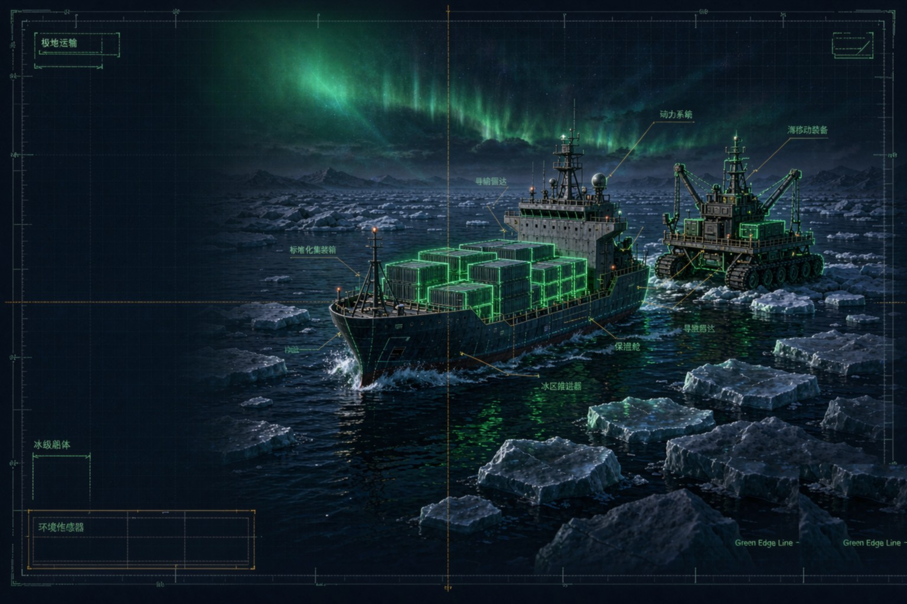

<!-- SINOSHOP SYSTEM STRIP:BEGIN -->
<table align="center">
<tr>
<td><b>🌊 SINOSHOP 星系</b></td>
<td><a href="https://gitee.com/sinoshop/sinoshop-hub">星系导航</a></td>
<td><a href="https://sinoshop-open.github.io/webpage/">官网</a></td>
<td><a href="https://sinoshop-open.github.io/webpage/docs/evidence/index.html">验证证据</a></td>
<td><a href="https://sinoshop-open.github.io/webpage/docs/datasets/index.html">数据集总览</a></td>
<td><a href="https://sinoshop-open.github.io/webpage/whitepaper.html">技术白皮书</a></td>
</tr>
</table>
<!-- SINOSHOP SYSTEM STRIP:END -->
<!-- STAR:HERO:START -->
<div align="center">


> 🌊 [SINOSHOP 技术导航中枢](https://gitee.com/sinoshop/sinoshop-hub) · [综合讨论](https://gitee.com/sinoshop/sinoshop-hub/issues) · 🌐 [SINOPORT 官网展示页](https://sinoshop-open.github.io/webpage/) · 💻 [SINOPORT 主仓库](https://gitee.com/sinoshop/SinoPORT) · 🐙 [GitHub 镜像组织](https://github.com/SINOSHOP-OPEN)


<br><br>

# SINOSHIP — Ship & Marine Mobile Equipment Platform

### SINOSHOP marine city simulation & digital co-creation ecosystem · Application layer

<br>

> **Observe Nature's Order, Align with Ocean's Rhythm.**
> **Carbon-based and silicon-based life in chorus** —— Sea Generates Power → Power Sustains Ships → Ships Bridge Cities → Cities Benefit People → Harmony for All Beings.

<br>

<code>🚢 Marine Equipment</code> &nbsp; <code>🧊 Polar Transport</code> &nbsp; <code>🏗️ Mobile Engineering</code> &nbsp; <code>Apache-2.0</code> &nbsp; 

<br>

### 🌐 星系导航 · STAR NAVIGATION

**🌐 [SINOPORT 官网展示页](https://sinoshop-open.github.io/webpage/) ｜ 💻 [SINOPORT 主仓库](https://gitee.com/sinoshop/SinoPORT) ｜ 🐙 [GitHub 镜像组织](https://github.com/SINOSHOP-OPEN)**

</div>

<!-- STAR:HERO:END -->

# SINOSHIP — Ship & Marine Mobile Equipment Platform

**Ship Design and Shipping Open-Source Infrastructure**

> *Observe Nature's Order, Align with Ocean's Rhythm. Three exchanges held in balance, the Three Talents rest secure.*

---

## 🌊 Brand Positioning

SINOSHIP is the application-layer project within the SINOSHOP marine city simulation and digital co-creation ecosystem, focusing on the engineering realization of ships, polar transport, and mobile marine equipment.

**One-Line Positioning**: *Ship and Marine Mobile Equipment Engineering Application Layer*

**Engineering Creed**:

> *Sea Generates Power → Power Sustains Ships → Ships Bridge Cities → Cities Benefit People → Aerospace for All → Harmony for All Beings.*

---

## 🏗️ Technical Positioning

SINOSHIP's role within the SINOSHOP ecosystem:

| Layer | Project | Responsibility |
| :--- | :--- | :--- |
| **Theory** | SINOSFT | Mathematical kernel, formal verification, infrastructure standards |
| **Platform** | SINOSHOP | Fixed/semi-fixed marine infrastructure systems |
| **Equipment** | **SINOSHIP** | Ships and mobile marine equipment (including polar hydrogen energy) |

---

## 🚢 Core Capabilities

[Retain your original technical content here]

---

## 📜 Open Source License

This project is licensed under the **Apache License 2.0**.

Derivative works must retain the SINOSHOP copyright notice and brand philosophy statement.

---

## 🤝 Contributing

Issues and Pull Requests are welcome.

> *Steadfast loyalty glowing like the sun and moon; Benevolence nourishing the tide of time.*

---

## 📌 Project Overview

SINOSHIP is an open-source infrastructure project for ship design and shipping, providing ship modeling, simulation, and optimization tools.

---

## 🧬 Technology Source & Architecture

This repository is part of the SINOSHOP marine space intelligent ecological matrix, providing infrastructure tools for the "Ships and Shipping" dimension.

- **Top-Level Specification**: [SINOSHOP-OS](https://gitee.com/sinoshop/sinoshop-os) defines the SLFS (Super Large Floating Structure) core architecture and physical baseline (135m × 27m, five-layer load cancellation system)
- **Theoretical Foundation**: [SINOSFT](https://gitee.com/sinoshop/sinosft) provides the mathematical axioms and numerical simulation standards for Submerged Floating Tunnel infrastructure
- **Related Application**: [sinoshop-openice](https://gitee.com/SINOSHIP/sinoshop-openice) — a polar hydrogen energy simulation and verification platform based on the SLFS architecture

---

## 🛠️ Technology Stack

| Tool | Purpose |
| :--- | :--- |
| **Python 3.8+** | Primary development language |
| **unittest** | Testing framework |

---

## 🚀 Quick Start

### Clone the Repository
```bash
git clone https://github.com/SINOSHOP-OPEN/Sinoship.git
cd sinoship
